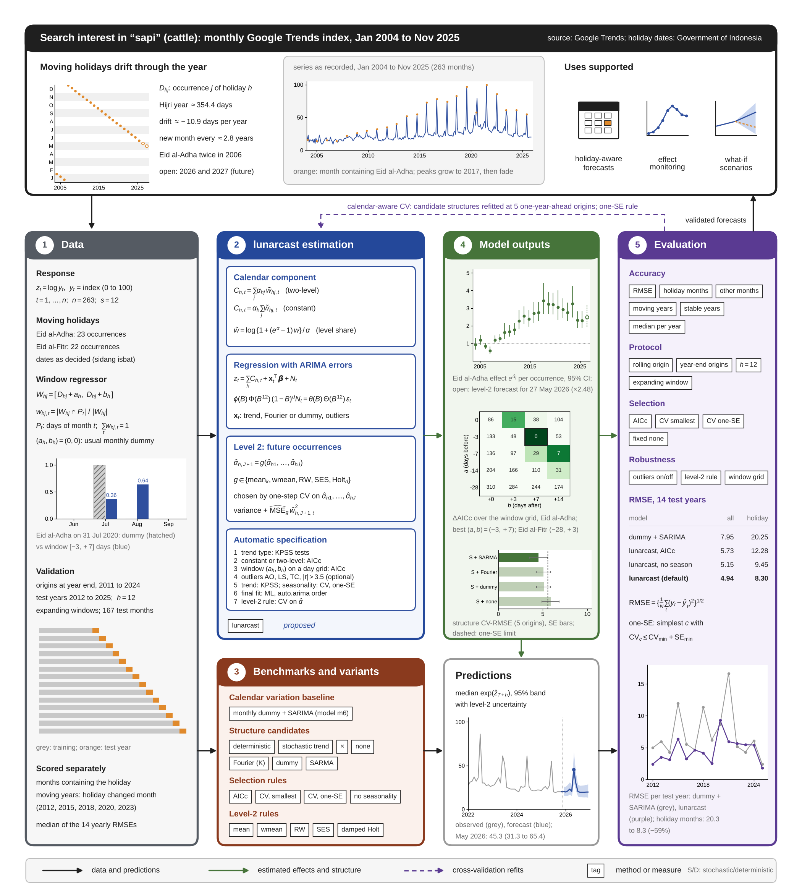

<!-- README.md is generated from README.Rmd. Please edit that file -->

```{r, include = FALSE}
knitr::opts_chunk$set(
  collapse = TRUE,
  comment = "#>",
  fig.path = "man/figures/README-",
  out.width = "100%",
  dpi = 150,
  fig.width = 7,
  fig.height = 3.6
)
```

# lunarcast 

<!-- badges: start -->
[](https://github.com/novrisuhermi/lunarcast/actions/workflows/R-CMD-check.yaml)
[](https://lifecycle.r-lib.org/articles/stages.html#experimental)
[](https://www.gnu.org/licenses/gpl-3.0)
<!-- badges: end -->

**lunarcast** forecasts monthly and quarterly time series that react to
**moving holidays**: holidays whose Gregorian date changes every year, such as
Eid al-Fitr, Eid al-Adha, the Chinese New Year and Easter. Most of them follow
the moon, hence the name.

The classical *calendar variation model* puts a dummy for the holiday month
into a regression with ARIMA errors and assumes the same effect every year.
lunarcast relaxes each of its assumptions:

* **Window regressors.** A holiday affects the days around it, so the effect is
  spread over the months in proportion to the days of a window around the
  holiday that fall in each month. The window is selected from the data.
* **Two-level effects.** Every occurrence of a holiday gets its own effect
  (level 1), and the effect of the next occurrence is forecast from the
  sequence of past effects (level 2), with its uncertainty.
* **Calendar-aware selection.** After the calendar part has been specified,
  so that the seasonal part cannot absorb the holiday effect, the trend type
  is chosen by KPSS tests and the seasonality (none, Fourier terms, dummies or
  seasonal ARIMA, the building blocks of the six classical structures) by
  cross-validated forecasts with a one-standard-error rule.

The classical model is included too (`calvar_classic()`), as a benchmark and
as a special case of lunarcast.

## Installation

lunarcast is not on CRAN yet. Install the development version from GitHub:

```r
# install.packages("pak")
pak::pak("novrisuhermi/lunarcast")
```

To also build the vignettes (tutorial, theory, comparison and an Indonesian
guide):

```r
# install.packages("remotes")
remotes::install_github("novrisuhermi/lunarcast", build_vignettes = TRUE)
browseVignettes("lunarcast")
```

lunarcast needs R 4.1 or later and depends only on the
[forecast](https://pkg.robjhyndman.com/forecast/) package.

## Example

`sapi` is the monthly Google Trends index for "sapi" (cattle) in Indonesia.
Searches peak before Eid al-Adha, when cattle are bought for the sacrifice.

```{r fit, message = FALSE}
library(lunarcast)

hol <- list(adha  = holiday_dates("idul_adha"),
            fitri = holiday_dates("idul_fitri"))

fit <- lunarcast(sapi, hol)   # fully automatic, about a minute
fit
```

The selected model spreads Eid al-Adha over a window from 3 days before to
7 days after the holiday, lets its effect differ every year, and adds a
constant Eid al-Fitr effect over the last four weeks of Ramadan.

```{r effects, fig.alt = "Estimated Eid al-Adha effect for every occurrence with 95% intervals and the forecast for 2026"}
plot(fit)
```

The effect of Eid al-Adha grew from almost nothing in 2004 to more than three
times the usual level and has declined since; the open circle is the forecast
for the next occurrence.

```{r forecast, fig.alt = "Forecast of the sapi series with a 95% interval"}
fc <- forecast(fit, h = 13)
plot(fc, include = 60)
fc$future_effects
```

Scenarios fix the effect of the next occurrence:

```{r scenario}
sc <- forecast(fit, h = 13, level2 = list(adha = log(2)))   # doubles the level
round(cbind(model = fc$mean, scenario = sc$mean)[5:7, ], 1)
```

The classical model in one line, here m6 (stochastic trend and seasonality):

```{r classic}
calvar_classic(sapi, hol$adha, trend = "stochastic", season = "stochastic")
```

## How it works



On the log scale, with $z_t = \log y_t$,

$$
z_t = \sum_h \sum_j \alpha_{hj}\,\tilde w_{hj,t} + \mathbf{x}_t^\top\boldsymbol\beta + N_t,
\qquad
w_{hj,t} = \frac{|[D_{hj} + a_h,\ D_{hj} + b_h] \cap P_t|}{b_h - a_h + 1},
$$

where $D_{hj}$ is the date of occurrence $j$ of holiday $h$, $P_t$ the days of
month $t$, $\tilde w = \log\{1 + (e^{\alpha} - 1) w\}/\alpha$ maps the window
shares to the log scale, $\mathbf{x}_t$ holds the trend, seasonal and outlier
regressors and $N_t$ is an ARIMA error. The next effect is forecast as
$\hat\alpha_{h,J+1} = g(\hat\alpha_{h1}, \ldots, \hat\alpha_{hJ})$, with $g$
chosen by cross-validation among the mean, a precision-weighted mean, a random
walk, exponential smoothing and damped Holt.

The full explanation, written to be read without prior knowledge of calendar
effects, is in `vignette("theory")`.

## Does it forecast better?

Fourteen test years (2012 to 2025) of rolling-origin forecasts of `sapi`
(see `vignette("classic-vs-lunarcast")`):

| Model | RMSE | RMSE in holiday months |
|:--|--:|--:|
| Classical m1 (deterministic trend, dummies) | 10.42 | 27.12 |
| Classical m6 (stochastic trend and seasonality), best classical | 7.95 | 20.25 |
| lunarcast, structure chosen by AICc | 5.73 | 12.28 |
| **lunarcast (default)** | **4.94** | **8.30** |

These results come from a single series; they show what the method can do,
not a general ranking.

## Functions

| Function | Purpose |
|:--|:--|
| `lunarcast()` | automatic two-level calendar variation model |
| `forecast()` | forecasts and scenarios for every model in the package |
| `holiday_effects()` | effect of every holiday occurrence |
| `calvar_classic()`, `calvar_classic_all()` | classical model, structures m1 to m6 |
| `holiday_dates()`, `easter_dates()` | Indonesian holiday dates, Easter-based holidays |
| `holiday_window()` | window regressors from any vector of dates |
| `rolling_origin()`, `rolling_summary()` | calendar-aware rolling-origin evaluation |
| `forecast_accuracy()` | RMSE, MAE, MAPE and sMAPE |

## Learn more

* `vignette("lunarcast")`: get started, a complete analysis step by step.
* `vignette("theory")`: how lunarcast works.
* `vignette("classic-vs-lunarcast")`: the classical model and the evaluation.
* `vignette("panduan-indonesia")`: panduan dalam Bahasa Indonesia.
* Website: <https://novrisuhermi.github.io/lunarcast/>

## Ringkasan (Bahasa Indonesia)

**lunarcast** adalah package R untuk memodelkan dan meramal deret waktu
bulanan atau kuartalan yang dipengaruhi hari raya bergerak, seperti Idul
Fitri, Idul Adha, Imlek, dan Paskah. Dibanding model variasi kalender klasik
(dummy bulan hari raya dengan efek tetap), lunarcast:

1. menyebar efek hari raya ke beberapa bulan sesuai porsi hari dalam jendela
   di sekitar hari raya, dengan jendela yang dipilih otomatis;
2. memberi setiap kejadian hari raya efeknya sendiri dan meramal efek
   kejadian berikutnya dari deret efek sebelumnya (model dua level);
3. memilih struktur tren dan musiman lewat validasi silang yang sadar
   kalender.

Instalasi: `pak::pak("novrisuhermi/lunarcast")`. Panduan lengkap berbahasa
Indonesia: `vignette("panduan-indonesia")`.

## Citation

```{r citation, echo = FALSE, comment = ""}
print(citation("lunarcast"), style = "text")
```

## Code of Conduct

Please note that the lunarcast project is released with a
[Contributor Code of Conduct](https://novrisuhermi.github.io/lunarcast/CODE_OF_CONDUCT.html).
By contributing to this project, you agree to abide by its terms.
