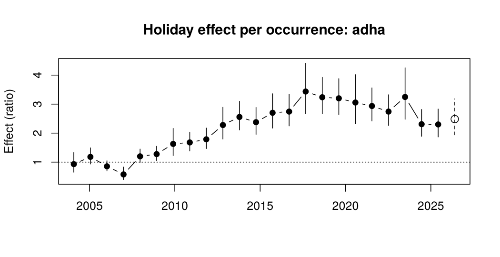
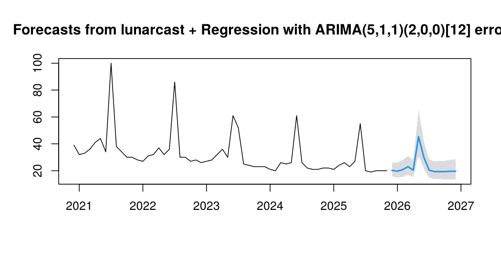
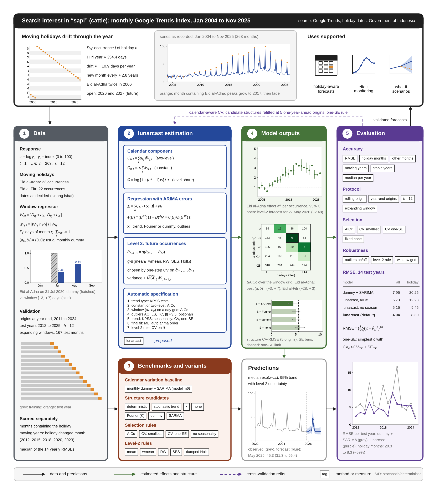

<!-- README.md is generated from README.Rmd. Please edit that file -->

# lunarcast 

<!-- badges: start -->

[](https://lifecycle.r-lib.org/articles/stages.html#experimental)
[](https://www.gnu.org/licenses/gpl-3.0)
<!-- badges: end -->

**lunarcast** forecasts monthly and quarterly time series that react to
**moving holidays**: holidays whose Gregorian date changes every year,
such as Eid al-Fitr, Eid al-Adha, the Chinese New Year and Easter. Most
of them follow the moon, hence the name.

The classical *calendar variation model* puts a dummy for the holiday
month into a regression with ARIMA errors and assumes the same effect
every year. lunarcast relaxes each of its assumptions:

- **Window regressors.** A holiday affects the days around it, so the
  effect is spread over the months in proportion to the days of a window
  around the holiday that fall in each month. The window is selected
  from the data.
- **Two-level effects.** Every occurrence of a holiday gets its own
  effect (level 1), and the effect of the next occurrence is forecast
  from the sequence of past effects (level 2), with its uncertainty.
- **Calendar-aware selection.** After the calendar part has been
  specified, so that the seasonal part cannot absorb the holiday effect,
  the trend type is chosen by KPSS tests and the seasonality (none,
  Fourier terms, dummies or seasonal ARIMA, the building blocks of the
  six classical structures) by cross-validated forecasts with a
  one-standard-error rule.

The classical model is included too (`calvar_classic()`), as a benchmark
and as a special case of lunarcast.

## Installation

lunarcast is not on CRAN yet. Install the development version from
GitHub:

``` r
# install.packages("pak")
pak::pak("novrisuhermi/lunarcast")
```

`pak::pak()` does not build the vignettes; read them online at
<https://novrisuhermi.github.io/lunarcast/vignettes/> or install with:

``` r
# install.packages("remotes")
remotes::install_github("novrisuhermi/lunarcast", build_vignettes = TRUE)
browseVignettes("lunarcast")
```

lunarcast needs R 4.1 or later and depends only on the
[forecast](https://pkg.robjhyndman.com/forecast/) package.

## Example

`sapi` is the monthly Google Trends index for “sapi” (cattle) in
Indonesia. Searches peak before Eid al-Adha, when cattle are bought for
the sacrifice.

``` r
library(lunarcast)

hol <- list(adha  = holiday_dates("idul_adha"),
            fitri = holiday_dates("idul_fitri"))

fit <- lunarcast(sapi, hol)   # fully automatic, about a minute
fit
#> lunarcast: Regression with ARIMA(5,1,1)(2,0,0)[12] errors | AICc = -296.9 
#> Structure (cv, 1se): stochastic + SARMA(2,0,0), d = 1
#> Cross-validated RMSE of the candidate structures:
#>                  structure RMSE    SE
#>  stochastic + SARMA(2,0,0) 4.53 1.017
#>  stochastic + fourier(K=4) 5.08 0.821
#>         stochastic + dummy 5.10 0.795
#>          stochastic + none 5.86 0.962
#> 
#> adha: two-level effect, window [-3, +7] days, level 2 = wmean (CV-RMSE 0.13)
#>       event   alpha     se ratio
#>  2004-02-01 -0.0712 0.1816 0.931
#>  2005-01-21  0.1664 0.1196 1.181
#>  2006-01-10 -0.1558 0.1029 0.856
#>  2006-12-31 -0.5505 0.1860 0.577
#>  2007-12-20  0.1819 0.0964 1.199
#>  2008-12-08  0.2440 0.0978 1.276
#>  2009-11-27  0.4874 0.1452 1.628
#>  2010-11-17  0.5180 0.0976 1.679
#>  2011-11-06  0.5801 0.1003 1.786
#>  2012-10-26  0.8234 0.1213 2.278
#>  2013-10-15  0.9386 0.0980 2.556
#>  2014-10-05  0.8655 0.0993 2.376
#>  2015-09-24  0.9935 0.1108 2.701
#>  2016-09-12  1.0087 0.1012 2.742
#>  2017-09-01  1.2335 0.1277 3.433
#>  2018-08-22  1.1742 0.0980 3.236
#>  2019-08-11  1.1629 0.0981 3.199
#>  2020-07-31  1.1167 0.1392 3.055
#>  2021-07-20  1.0764 0.0985 2.934
#>  2022-07-10  1.0088 0.0979 2.742
#>  2023-06-29  1.1770 0.1382 3.245
#>  2024-06-17  0.8363 0.1013 2.308
#>  2025-06-06  0.8326 0.1057 2.299
#> 
#> fitri: constant effect, window [-28, +3] days
#>  alpha     se ratio
#>  0.147 0.0346  1.16
```

The selected model spreads Eid al-Adha over a window from 3 days before
to 7 days after the holiday, lets its effect differ every year, and adds
a constant Eid al-Fitr effect over the last four weeks of Ramadan.

``` r
plot(fit)
```



The effect of Eid al-Adha grew from almost nothing in 2004 to more than
three times the usual level and has declined since; the open circle is
the forecast for the next occurrence.

``` r
fc <- forecast(fit, h = 13)
plot(fc, include = 60)
```



``` r
fc$future_effects
#> $adha
#>        event     alpha       se method    ratio
#> 1 2026-05-27 0.9095093 0.126112  wmean 2.483104
```

Scenarios fix the effect of the next occurrence:

``` r
sc <- forecast(fit, h = 13, level2 = list(adha = log(2)))   # doubles the level
round(cbind(model = fc$mean, scenario = sc$mean)[5:7, ], 1)
#>      model scenario
#> [1,]  20.4     20.4
#> [2,]  45.3     37.6
#> [3,]  29.9     27.1
```

The classical model in one line, here m6 (stochastic trend and
seasonality):

``` r
calvar_classic(sapi, hol$adha, trend = "stochastic", season = "stochastic")
#> Classical calendar variation model: stochastic trend + stochastic seasonality 
#> Regression with ARIMA(1,1,1)(1,0,2)[12] errors | AICc = 1708.9 
#> Holiday effect (same every year): 18.92 (s.e. 2.01), original scale
```

## How it works

<figure>

<figcaption aria-hidden="true">The lunarcast modelling
pipeline</figcaption>
</figure>

On the log scale, with $z_t = \log y_t$,

$$
z_t = \sum_h \sum_j \alpha_{hj}\,\tilde w_{hj,t} + \mathbf{x}_t^\top\boldsymbol\beta + N_t,
\qquad
w_{hj,t} = \frac{|[D_{hj} + a_h,\ D_{hj} + b_h] \cap P_t|}{b_h - a_h + 1},
$$

where $D_{hj}$ is the date of occurrence $j$ of holiday $h$, $P_t$ the
days of month $t$, $\tilde w = \log\{1 + (e^{\alpha} - 1) w\}/\alpha$
maps the window shares to the log scale, $\mathbf{x}_t$ holds the trend,
seasonal and outlier regressors and $N_t$ is an ARIMA error. The next
effect is forecast as
$\hat\alpha_{h,J+1} = g(\hat\alpha_{h1}, \ldots, \hat\alpha_{hJ})$, with
$g$ chosen by cross-validation among the mean, a precision-weighted
mean, a random walk, exponential smoothing and damped Holt.

The full explanation, written to be read without prior knowledge of
calendar effects, is in `vignette("theory")`.

## Does it forecast better?

Fourteen test years (2012 to 2025) of rolling-origin forecasts of `sapi`
(see `vignette("classic-vs-lunarcast")`):

| Model                                                           |     RMSE | RMSE in holiday months |
|:----------------------------------------------------------------|---------:|-----------------------:|
| Classical m1 (deterministic trend, dummies)                     |    10.42 |                  27.12 |
| Classical m6 (stochastic trend and seasonality), best classical |     7.95 |                  20.25 |
| lunarcast, structure chosen by AICc                             |     5.73 |                  12.28 |
| **lunarcast (default)**                                         | **4.94** |               **8.30** |

These results come from a single series; they show what the method can
do, not a general ranking.

## Functions

| Function                                   | Purpose                                                |
|:-------------------------------------------|:-------------------------------------------------------|
| `lunarcast()`                              | automatic two-level calendar variation model           |
| `forecast()`                               | forecasts and scenarios for every model in the package |
| `holiday_effects()`                        | effect of every holiday occurrence                     |
| `calvar_classic()`, `calvar_classic_all()` | classical model, structures m1 to m6                   |
| `holiday_dates()`, `easter_dates()`        | Indonesian holiday dates, Easter-based holidays        |
| `holiday_window()`                         | window regressors from any vector of dates             |
| `rolling_origin()`, `rolling_summary()`    | calendar-aware rolling-origin evaluation               |
| `forecast_accuracy()`                      | RMSE, MAE, MAPE and sMAPE                              |

## Learn more

The vignettes are available already run and rendered, as on CRAN, at
<https://novrisuhermi.github.io/lunarcast/vignettes/>:

- [Get started with lunarcast](https://novrisuhermi.github.io/lunarcast/vignettes/lunarcast.html): a complete
  analysis step by step.
- [How lunarcast works](https://novrisuhermi.github.io/lunarcast/vignettes/theory.html): the theory, with
  equations.
- [From the classical model to lunarcast](https://novrisuhermi.github.io/lunarcast/vignettes/classic-vs-lunarcast.html):
  the classical models m1 to m6 and the evaluation.
- [Panduan lunarcast (Bahasa Indonesia)](https://novrisuhermi.github.io/lunarcast/vignettes/panduan-indonesia.html):
  panduan dalam Bahasa Indonesia.

The package website, <https://novrisuhermi.github.io/lunarcast/>, has the
same articles and the reference of every function.

## Ringkasan (Bahasa Indonesia)

**lunarcast** adalah package R untuk memodelkan dan meramal deret waktu
bulanan atau kuartalan yang dipengaruhi hari raya bergerak, seperti Idul
Fitri, Idul Adha, Imlek, dan Paskah. Dibanding model variasi kalender
klasik (dummy bulan hari raya dengan efek tetap), lunarcast:

1.  menyebar efek hari raya ke beberapa bulan sesuai porsi hari dalam
    jendela di sekitar hari raya, dengan jendela yang dipilih otomatis;
2.  memberi setiap kejadian hari raya efeknya sendiri dan meramal efek
    kejadian berikutnya dari deret efek sebelumnya (model dua level);
3.  memilih struktur tren dan musiman lewat validasi silang yang sadar
    kalender.

Instalasi: `pak::pak("novrisuhermi/lunarcast")`. Panduan lengkap
berbahasa Indonesia: `vignette("panduan-indonesia")`.

## Citation

    Suhermi N (2026). _lunarcast: Calendar Variation Models for Time Series
    with Moving Holidays_. R package version 0.1.1,
    <https://github.com/novrisuhermi/lunarcast>.

## Code of Conduct

Please note that the lunarcast project is released with a [Contributor
Code of
Conduct](https://novrisuhermi.github.io/lunarcast/CODE_OF_CONDUCT.html).
By contributing to this project, you agree to abide by its terms.
